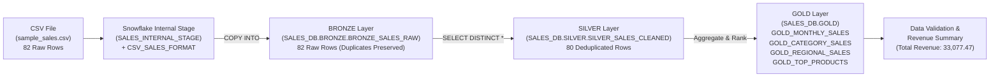
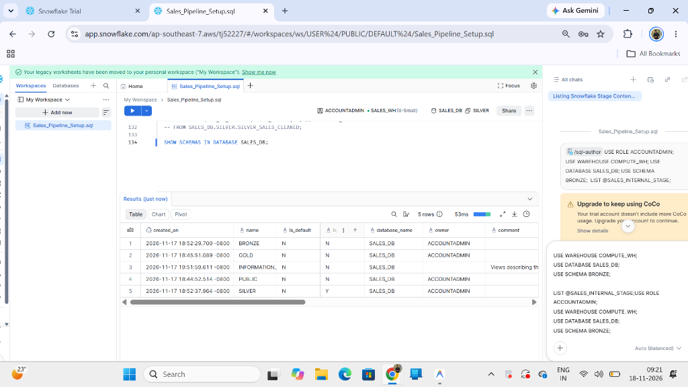
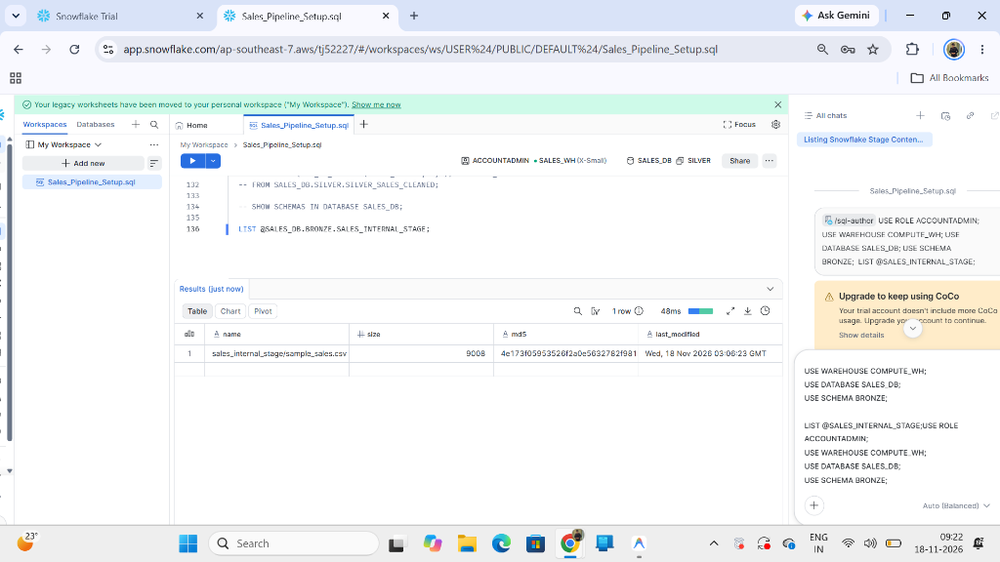
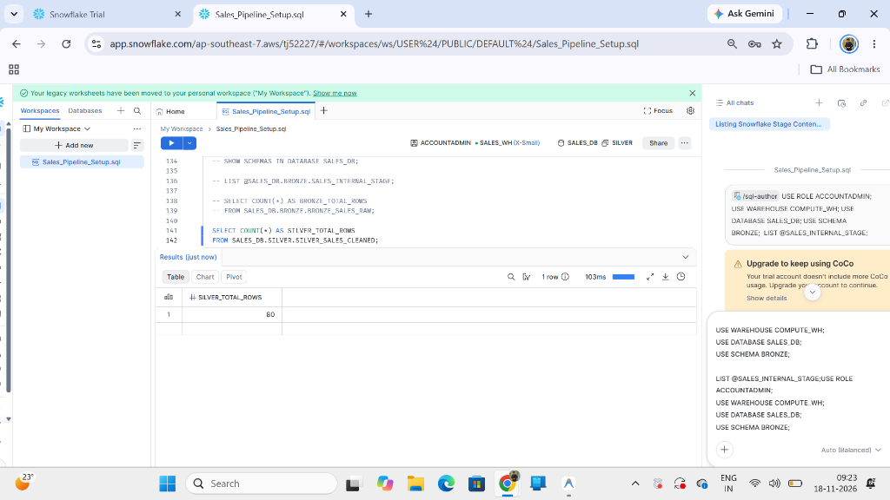
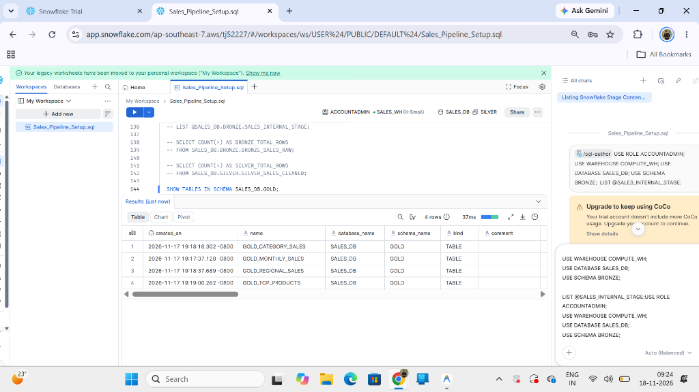
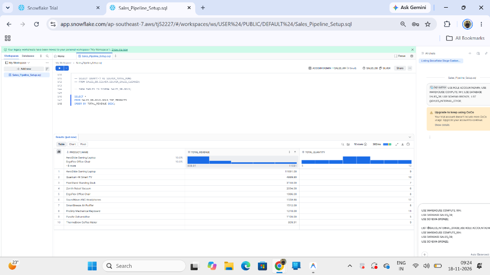
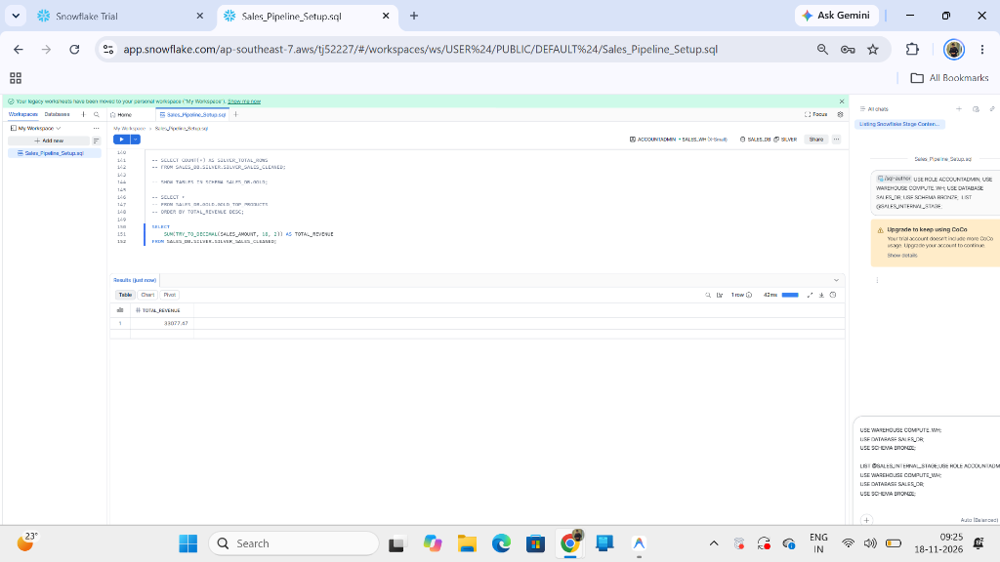

# Sales Data Engineering Pipeline – Snowflake Medallion Architecture

A beginner-friendly, end-to-end **Data Engineering** portfolio project built with **Snowflake** and **Snowflake SQL** using a **Snowflake Internal Stage** and the **Medallion Architecture (Bronze → Silver → Gold)**.

---

## Project Overview

This project demonstrates a clean, SQL-first data engineering workflow in Snowflake: uploading a raw sales CSV file to a **Snowflake Internal Stage**, loading the untouched raw records into the **Bronze** layer with `COPY INTO`, removing exact duplicate rows in the **Silver** layer using `SELECT DISTINCT *`, and building four analytical summary tables in the **Gold** layer.

### End-to-End Pipeline Flow

```text
CSV File (sample_sales.csv)
      ↓
Snowflake Internal Stage (SALES_INTERNAL_STAGE)
      ↓
BRONZE Layer  →  SALES_DB.BRONZE.BRONZE_SALES_RAW (82 raw rows)
      ↓
SILVER Layer  →  SALES_DB.SILVER.SILVER_SALES_CLEANED (80 deduplicated rows)
      ↓
GOLD Layer    →  4 Analytical Tables in SALES_DB.GOLD
```

---

## Architecture Diagram



*(Mermaid source: [`architecture/medallion_architecture.mmd`](architecture/medallion_architecture.mmd))*

---

## Technologies Used

- **Snowflake** (Cloud Data Warehouse & Snowsight Web UI)
- **Snowflake SQL** (`COPY INTO`, `SELECT DISTINCT`, CTEs, `GROUP BY`, `ORDER BY`, `SUM`, `COUNT`, `AVG`, `CASE WHEN`, `RANK()`)
- **Snowflake Internal Stage** (`SALES_INTERNAL_STAGE`) & **Named CSV File Format** (`CSV_SALES_FORMAT`)
- **Medallion Architecture** (`BRONZE`, `SILVER`, `GOLD` schemas in `SALES_DB`)
- **VS Code** & **Git / GitHub**

---

## Snowflake Objects Implemented

| Layer / Object | Name | Purpose |
| :--- | :--- | :--- |
| Virtual Warehouse | `SALES_WH` | `XSMALL` compute warehouse (`AUTO_SUSPEND = 60`, `AUTO_RESUME = TRUE`) |
| Database | `SALES_DB` | Container for all pipeline schemas and tables |
| Schemas | `BRONZE`, `SILVER`, `GOLD` | Separates raw, deduplicated, and analytical layers |
| File Format | `SALES_DB.BRONZE.CSV_SALES_FORMAT` | Defines CSV delimiter, header skipping, and blank field rules |
| Internal Stage | `SALES_DB.BRONZE.SALES_INTERNAL_STAGE` | Snowflake-managed stage where the CSV file is uploaded |
| Bronze Table | `SALES_DB.BRONZE.BRONZE_SALES_RAW` | Stores all `82` raw CSV records (duplicates preserved) |
| Silver Table | `SALES_DB.SILVER.SILVER_SALES_CLEANED` | Created via `SELECT DISTINCT *` from Bronze (`80` deduplicated rows) |
| Gold Tables (4) | `GOLD_MONTHLY_SALES`, `GOLD_CATEGORY_SALES`, `GOLD_REGIONAL_SALES`, `GOLD_TOP_PRODUCTS` | Aggregated business tables for monthly, category, regional, and top-product analysis |

---

## Project Folder Structure

```text
Snowflake-Sales-Data-Pipeline/
├── sql/
│   ├── 01_setup.sql
│   ├── 02_file_format_and_stage.sql
│   ├── 03_bronze_layer.sql
│   ├── 04_silver_layer.sql
│   ├── 05_gold_layer.sql
│   └── 06_data_validation.sql
├── data/
│   └── sample_sales.csv
├── docs/
│   ├── architecture.md
│   ├── snowflake_setup.md
│   └── interview_questions.md
├── screenshots/
│   └── README.md
├── architecture/
│   └── medallion_architecture.mmd
├── README.md
└── .gitignore
```

---

## Execution Steps (Snowsight)

Detailed setup instructions are in [`docs/snowflake_setup.md`](docs/snowflake_setup.md).

1. Run [`sql/01_setup.sql`](sql/01_setup.sql) — Creates `SALES_WH`, `SALES_DB`, and schemas `BRONZE`, `SILVER`, `GOLD`.
2. Run Parts 1–2 of [`sql/02_file_format_and_stage.sql`](sql/02_file_format_and_stage.sql) — Creates `CSV_SALES_FORMAT` and `SALES_INTERNAL_STAGE`.
3. Upload the sales CSV file to `SALES_INTERNAL_STAGE` using Snowsight's **`+ Files`** button, then run Part 3 (`LIST` & preview).
4. Run [`sql/03_bronze_layer.sql`](sql/03_bronze_layer.sql) — Loads all `82` raw records into `BRONZE_SALES_RAW` using `COPY INTO`.
5. Run [`sql/04_silver_layer.sql`](sql/04_silver_layer.sql) — Runs `SELECT DISTINCT * FROM SALES_DB.BRONZE.BRONZE_SALES_RAW` to create `SILVER_SALES_CLEANED` (`80` rows).
6. Run [`sql/05_gold_layer.sql`](sql/05_gold_layer.sql) — Creates the 4 Gold analytical tables (`GOLD_MONTHLY_SALES`, `GOLD_CATEGORY_SALES`, `GOLD_REGIONAL_SALES`, `GOLD_TOP_PRODUCTS`).
7. Run [`sql/06_data_validation.sql`](sql/06_data_validation.sql) — Runs row count, duplicate, NULL inspection, numeric sanity, and revenue reconciliation checks.

---

## Confirmed Snowflake Execution Results

| Metric | Confirmed Result |
| :--- | :--- |
| Bronze Table (`SALES_DB.BRONZE.BRONZE_SALES_RAW`) | **82 rows** |
| Exact Duplicate Rows Removed in Silver (`SELECT DISTINCT *`) | **2 rows** |
| Silver Table (`SALES_DB.SILVER.SILVER_SALES_CLEANED`) | **80 rows** |
| Total Cleaned Sales Revenue | **33,077.47** |
| Gold Analytical Tables Created | **4** (`GOLD_MONTHLY_SALES`, `GOLD_CATEGORY_SALES`, `GOLD_REGIONAL_SALES`, `GOLD_TOP_PRODUCTS`) |

> **Note on Sample CSV:** [`data/sample_sales.csv`](data/sample_sales.csv) is included in this repository as a local reference CSV with the same 11-column schema (`82` rows with `2` exact duplicates). The confirmed revenue figure (`33,077.47`) above reflects the actual executed Snowflake query output from the uploaded dataset.

---

## Future Improvements

- Add explicit `NULL`-handling defaults (e.g., `COALESCE`) and quarantine tables for invalid records in the Silver layer.
- Use `ROW_NUMBER()` for key-based deduplication when records share an `order_id` with updated timestamps.
- Add Snowflake Streams and Tasks for incremental automated processing.

---

## Documentation & Interview Prep

- [Architecture Guide](docs/architecture.md)
- [Snowflake Setup & Execution Guide](docs/snowflake_setup.md)
- [Internship Interview Questions & Answers](docs/interview_questions.md)
- [Screenshots Checklist](screenshots/README.md)

---

## Screenshots

All 7 live Snowflake Snowsight execution screenshots are saved in [`screenshots/`](screenshots/) (see [`screenshots/README.md`](screenshots/README.md)):

### 1. Database & Medallion Schemas (`BRONZE`, `SILVER`, `GOLD`)


### 2. Snowflake Internal Stage (`sample_sales.csv` – 9,008 bytes)


### 3. Bronze Layer (`BRONZE_SALES_RAW` – 82 rows)


### 4. Silver Layer (`SILVER_SALES_CLEANED` – 80 rows)


### 5. Gold Layer (4 Analytical Tables)


### 6. Top 10 Products (`GOLD_TOP_PRODUCTS`)


### 7. Confirmed Total Revenue (`33077.47`)

