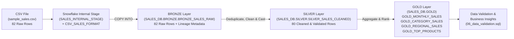

# Sales Data Engineering Pipeline – Snowflake Medallion Architecture

A beginner-friendly, end-to-end **Data Engineering** portfolio project built with **Snowflake** and **Snowflake SQL** using the **Medallion Architecture (Bronze → Silver → Gold)** and a **Snowflake Internal Stage**.

---

## Project Overview

Organizations frequently receive raw sales CSV files containing duplicate transactions, blank customer names, and unvalidated text fields. This project demonstrates how to ingest raw CSV data into Snowflake, clean and validate records systematically, and generate business-ready analytical tables for reporting.

### End-to-End Pipeline Flow

```text
Local CSV File (sample_sales.csv)
      ↓
Snowflake Internal Stage (SALES_INTERNAL_STAGE)
      ↓
BRONZE Layer  →  SALES_DB.BRONZE.BRONZE_SALES_RAW (82 raw rows)
      ↓
SILVER Layer  →  SALES_DB.SILVER.SILVER_SALES_CLEANED (80 cleaned rows)
      ↓
GOLD Layer    →  4 Analytical Tables in SALES_DB.GOLD
```

---

## Architecture Diagram



*(Mermaid source: [`architecture/medallion_architecture.mmd`](architecture/medallion_architecture.mmd))*

---

## Technologies Used

- **Snowflake** (Cloud Data Warehouse & Snowsight Web UI)
- **Snowflake SQL** (`COPY INTO`, CTEs, `ROW_NUMBER()`, `RANK()`, `COALESCE()`, `TRY_TO_DATE`, `TRY_TO_NUMBER`, `CASE WHEN`, `GROUP BY`)
- **Snowflake Internal Stage** (`SALES_INTERNAL_STAGE`) & **Named CSV File Format** (`CSV_SALES_FORMAT`)
- **Medallion Architecture** (`BRONZE`, `SILVER`, `GOLD` schemas in `SALES_DB`)
- **VS Code** & **Git / GitHub**

---

## Snowflake Objects Implemented

| Layer / Object | Name | Purpose |
| :--- | :--- | :--- |
| Virtual Warehouse | `SALES_WH` | `XSMALL` compute warehouse (`AUTO_SUSPEND = 60`, `AUTO_RESUME = TRUE`) |
| Database | `SALES_DB` | Container for all pipeline schemas and tables |
| Schemas | `BRONZE`, `SILVER`, `GOLD` | Separates raw, cleaned, and analytical layers |
| File Format | `SALES_DB.BRONZE.CSV_SALES_FORMAT` | Parses CSV delimiters, skips header, treats blank fields as `NULL` |
| Internal Stage | `SALES_DB.BRONZE.SALES_INTERNAL_STAGE` | Snowflake-managed stage for uploading `sample_sales.csv` |
| Bronze Table | `SALES_DB.BRONZE.BRONZE_SALES_RAW` | Stores all `82` raw CSV records + lineage metadata |
| Silver Table | `SALES_DB.SILVER.SILVER_SALES_CLEANED` | Stores `80` deduplicated, cleaned, properly typed records |
| Gold Tables (4) | `GOLD_MONTHLY_SALES`, `GOLD_CATEGORY_SALES`, `GOLD_REGIONAL_SALES`, `GOLD_TOP_PRODUCTS` | Aggregated business insights for reporting and dashboards |

---

## Project Folder Structure

```text
Snowflake-Sales-Data-Pipeline/
├── sql/
│   ├── 01_setup.sql
│   ├── 02_file_format_and_stage.sql
│   ├── 03_bronze_layer.sql
│   ├── 04_silver_layer.sql
│   ├── 05_gold_layer.sql
│   └── 06_data_validation.sql
├── data/
│   └── sample_sales.csv
├── docs/
│   ├── architecture.md
│   ├── snowflake_setup.md
│   └── interview_questions.md
├── screenshots/
│   └── README.md
├── architecture/
│   └── medallion_architecture.mmd
├── README.md
└── .gitignore
```

---

## Execution Steps (Snowsight)

Detailed walkthrough available in [`docs/snowflake_setup.md`](docs/snowflake_setup.md).

1. Run [`sql/01_setup.sql`](sql/01_setup.sql) — Creates `SALES_WH`, `SALES_DB`, and schemas `BRONZE`, `SILVER`, `GOLD`.
2. Run Parts 1–2 of [`sql/02_file_format_and_stage.sql`](sql/02_file_format_and_stage.sql) — Creates `CSV_SALES_FORMAT` and `SALES_INTERNAL_STAGE`.
3. Upload [`data/sample_sales.csv`](data/sample_sales.csv) to `SALES_INTERNAL_STAGE` using Snowsight's **`+ Files`** button, then run Part 3 of `02_file_format_and_stage.sql` (`LIST` & preview).
4. Run [`sql/03_bronze_layer.sql`](sql/03_bronze_layer.sql) — Loads all `82` raw records into `BRONZE_SALES_RAW` using `COPY INTO`.
5. Run [`sql/04_silver_layer.sql`](sql/04_silver_layer.sql) — Removes exact duplicates, defaults blank customer names to `'Unknown Customer'`, casts data types safely, and loads `80` valid rows into `SILVER_SALES_CLEANED`.
6. Run [`sql/05_gold_layer.sql`](sql/05_gold_layer.sql) — Creates all 4 analytical Gold tables.
7. Run [`sql/06_data_validation.sql`](sql/06_data_validation.sql) — Validates row counts, duplicates, NULLs, sales math, and cross-layer revenue totals.

---

## Actual Pipeline & Validation Results

### Layer & Data Quality Summary

| Metric | Result |
| :--- | :--- |
| Bronze Raw Records (`BRONZE_SALES_RAW`) | **82** |
| Exact Duplicate Records Removed (`ORD-1005`, `ORD-1042`) | **2** |
| Silver Cleaned Records (`SILVER_SALES_CLEANED`) | **80** |
| Blank `customer_name` Standardized (`ORD-1025`, `ORD-1062` → `'Unknown Customer'`) | **2** |
| Remaining `NULL` Values in Silver | **0** |
| Sales Amount Math Mismatches (`quantity * unit_price`) | **0** |
| Unique Customers | **20** |
| Total Cleaned Revenue | **$36,939.50** |
| Average Order Value (AOV) | **$461.74** |
| Silver vs. Gold Revenue Reconciliation | **PASS (0.00 variance)** |

### Gold Layer Highlights

**Category Sales (`GOLD_CATEGORY_SALES`):**

| Category | Orders | Total Revenue | Revenue Share |
| :--- | ---: | ---: | ---: |
| Electronics | 27 | $23,560.00 | 63.78% |
| Furniture | 18 | $7,890.00 | 21.36% |
| Accessories | 22 | $3,890.00 | 10.53% |
| Office Supplies | 13 | $1,599.50 | 4.33% |

**Regional Sales (`GOLD_REGIONAL_SALES`):**

| Region | Orders | Total Revenue | Performance Tier |
| :--- | ---: | ---: | :--- |
| North | 22 | $12,820.00 | Above Average |
| East | 20 | $9,947.50 | Above Average |
| West | 19 | $8,511.00 | Below Average |
| South | 19 | $5,661.00 | Below Average |

---

## Documentation & Interview Prep

- [Architecture Guide](docs/architecture.md)
- [Snowflake Setup & Execution Guide](docs/snowflake_setup.md)
- [Internship Interview Questions & Answers](docs/interview_questions.md)
- [Screenshots Checklist](screenshots/README.md)

---

## Screenshots

The [`screenshots/`](screenshots/) folder is ready for your actual Snowflake Snowsight screenshots (database/schemas, internal stage upload, Bronze `COPY INTO`, Silver cleaned output, Gold tables, and validation results). See [`screenshots/README.md`](screenshots/README.md) for the naming checklist.
