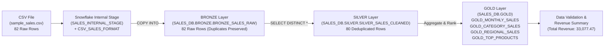

# Architecture Guide – Snowflake Medallion Pipeline

## 1. What Is Medallion Architecture?

**Medallion Architecture** organizes data inside a data warehouse into three clear layers:

```text
CSV File
      ↓
Snowflake Internal Stage (SALES_INTERNAL_STAGE)
      ↓
BRONZE Layer  →  Raw data (BRONZE_SALES_RAW – 82 rows)
      ↓
SILVER Layer  →  Deduplicated data (SILVER_SALES_CLEANED – 80 rows)
      ↓
GOLD Layer    →  4 Analytical summary tables in SALES_DB.GOLD
```

---

## 2. Diagram



*(Diagram source file: `architecture/medallion_architecture.mmd`)*

---

## 3. Layer-by-Layer Breakdown

### Landing: Snowflake Internal Stage (`SALES_INTERNAL_STAGE`)
- **What it is:** A built-in storage area managed directly inside Snowflake (no external cloud storage required).
- **What happens here:** The CSV file is uploaded directly via the Snowsight UI. `CSV_SALES_FORMAT` defines comma delimiters, header skipping, and empty-field parsing.

### Bronze Layer (`SALES_DB.BRONZE.BRONZE_SALES_RAW`)
- **Purpose:** Store the raw ingested records directly from the uploaded CSV using `COPY INTO`.
- **Key behavior:** Exact duplicates are intentionally preserved (`82` rows loaded) so Bronze serves as an untouched copy of the source file.

### Silver Layer (`SALES_DB.SILVER.SILVER_SALES_CLEANED`)
- **Purpose:** Provide a deduplicated dataset for downstream analytics.
- **Why deduplicate in Silver instead of editing Bronze?** Keeping Bronze unchanged preserves an audit copy of the original upload while allowing Silver to be rebuilt anytime.
- **Implemented transformation:**
  ```sql
  CREATE OR REPLACE TABLE SALES_DB.SILVER.SILVER_SALES_CLEANED AS
  SELECT DISTINCT *
  FROM SALES_DB.BRONZE.BRONZE_SALES_RAW;
  ```
- **Confirmed result:** `80` deduplicated rows (`2` exact duplicates removed) with confirmed total revenue of `33,077.47`.

### Gold Layer (`SALES_DB.GOLD`)
- **Purpose:** Pre-aggregated tables tailored for business reporting and analytics queries.
- **Tables created (4):**
  1. `GOLD_MONTHLY_SALES` – Monthly orders, customers, units sold, total revenue, and average order value.
  2. `GOLD_CATEGORY_SALES` – Revenue, order count, units sold, revenue share %, and rank by category.
  3. `GOLD_REGIONAL_SALES` – Revenue, order count, customers, and above/below average performance tier by region.
  4. `GOLD_TOP_PRODUCTS` – Top 10 products ranked by total revenue.
