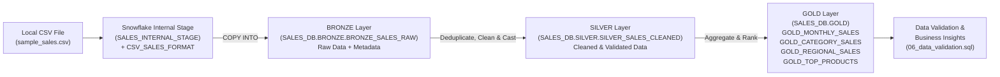

# Architecture Guide – Snowflake Medallion Pipeline

## 1. What Is Medallion Architecture?

**Medallion Architecture** is a simple, industry-standard way to organize data inside a cloud data warehouse into three layers of increasing quality:

```text
Local CSV File
      ↓
Snowflake Internal Stage (SALES_INTERNAL_STAGE)
      ↓
BRONZE Layer  →  Raw data (unchanged copy of uploaded CSV)
      ↓
SILVER Layer  →  Cleaned, deduplicated, and properly typed data
      ↓
GOLD Layer    →  Business-ready summary tables for reporting
```

---

## 2. Diagram



*(Diagram source file: `architecture/medallion_architecture.mmd`)*

---

## 3. Layer-by-Layer Breakdown

### Landing: Snowflake Internal Stage (`SALES_INTERNAL_STAGE`)
- **What it is:** A built-in storage area managed directly inside Snowflake (included free in the Snowflake trial—no external cloud storage required).
- **What happens here:** You upload `data/sample_sales.csv` using the Snowsight UI. `CSV_SALES_FORMAT` tells Snowflake how to parse commas, headers, and blank fields.

### Bronze Layer (`SALES_DB.BRONZE.BRONZE_SALES_RAW`)
- **Purpose:** Store an exact raw copy of the incoming file.
- **Key rules:**
  - Every business column is stored as `VARCHAR` (text) so unexpected data formats never crash ingestion.
  - Exact duplicates are **kept** on purpose for auditing.
  - Adds lineage metadata: `source_file_name`, `source_file_row_number`, and `ingested_at`.

### Silver Layer (`SALES_DB.SILVER.SILVER_SALES_CLEANED`)
- **Purpose:** Create one clean, trusted source of truth.
- **Why clean in Silver instead of editing Bronze?** Keeping Bronze untouched gives you a permanent backup. If cleaning rules change later, you can rebuild Silver without re-uploading files.
- **Key rules:**
  - Removes exact duplicate records using `ROW_NUMBER()`.
  - Replaces blank/NULL `customer_name` values with `'Unknown Customer'`.
  - Safely casts text to `DATE`, `INTEGER`, `NUMBER(10, 2)`, and `NUMBER(12, 2)` using `TRY_TO_DATE` and `TRY_TO_NUMBER`.
  - Filters out invalid rows (missing IDs/dates, non-positive quantity/price, or `sales_amount ≠ quantity * unit_price`).

### Gold Layer (`SALES_DB.GOLD`)
- **Purpose:** Fast, pre-aggregated tables ready for business questions and dashboards.
- **Tables created:**
  1. `GOLD_MONTHLY_SALES` – Monthly orders, units sold, total revenue, and average order value.
  2. `GOLD_CATEGORY_SALES` – Revenue, share %, and rank per product category.
  3. `GOLD_REGIONAL_SALES` – Revenue per region with `Above Average` / `Below Average` tiering.
  4. `GOLD_TOP_PRODUCTS` – Top 10 best-selling products ranked by revenue.
