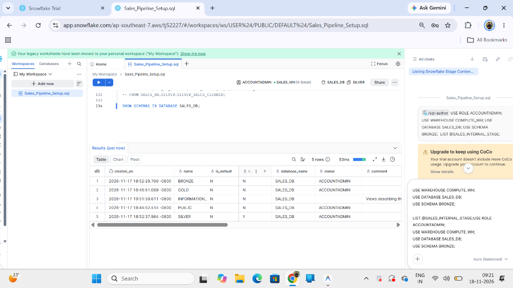
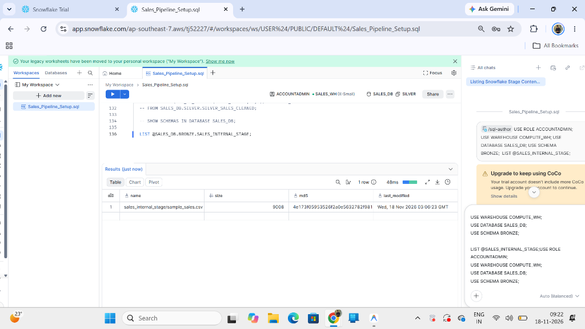
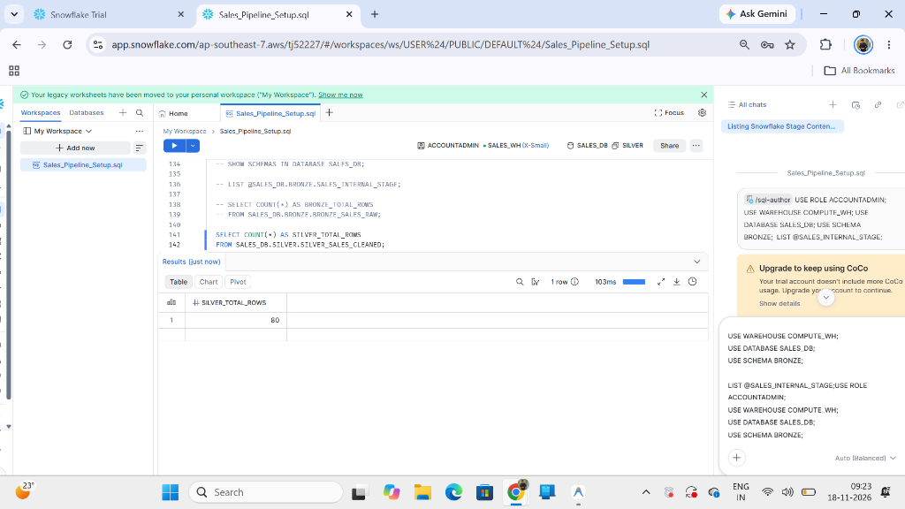
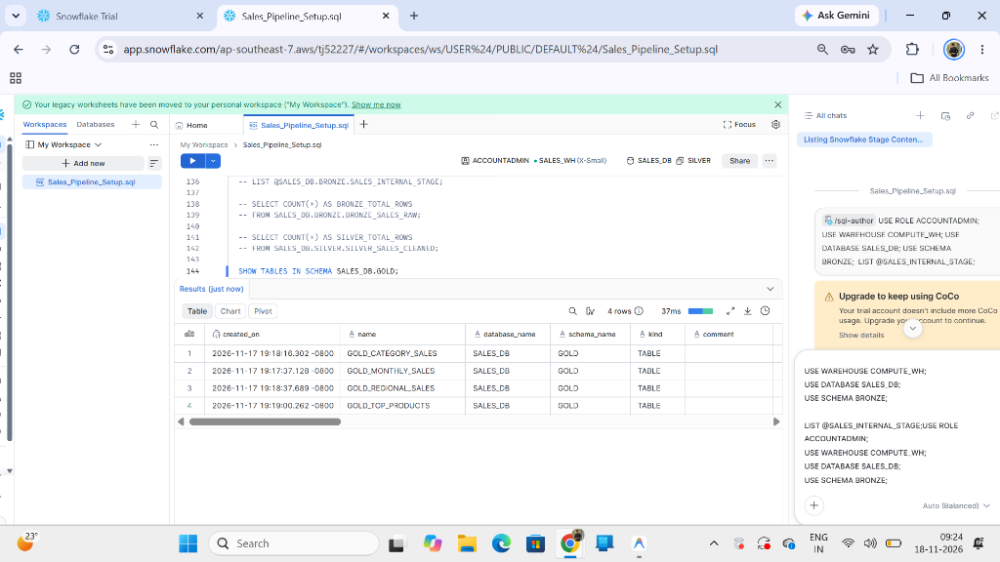
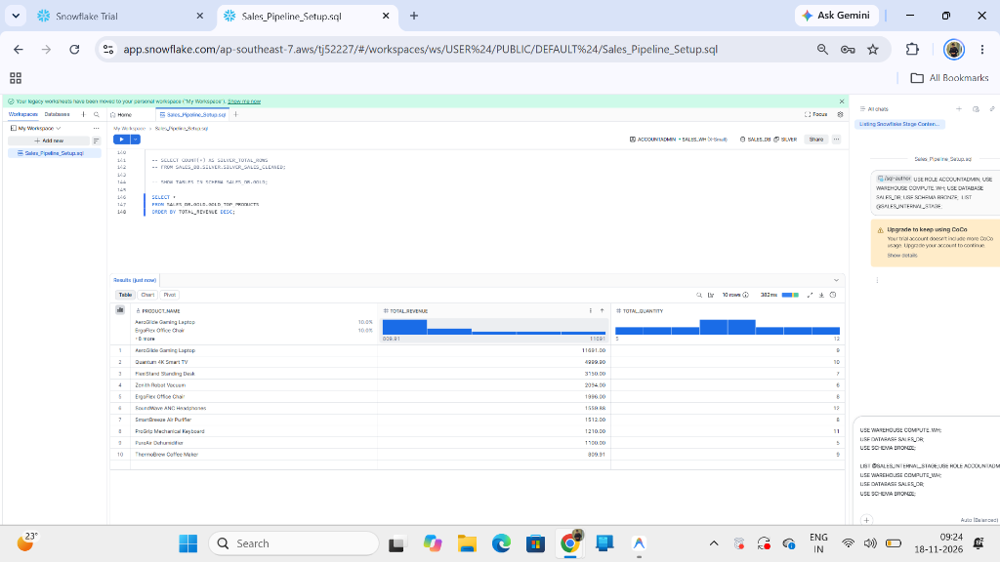
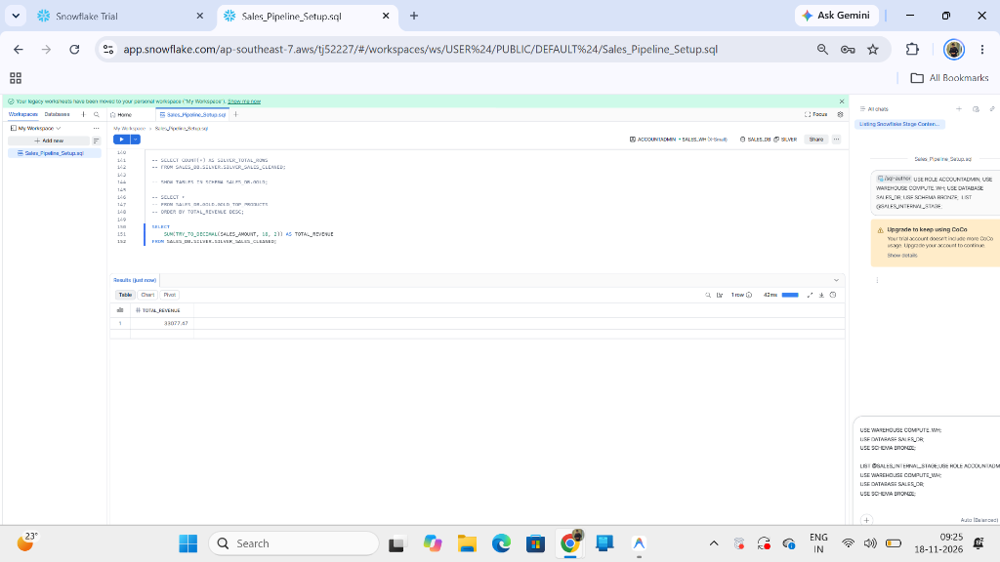

# Snowflake Execution Screenshots (7/7 Verified)

All seven live Snowflake Snowsight execution screenshots from `SALES_DB` (`SALES_WH` X-Small warehouse) are captured below.

## Checklist (`7/7` Completed)

- [x] **1. Database schemas** (`SHOW SCHEMAS IN DATABASE SALES_DB;`) – `BRONZE`, `SILVER`, `GOLD`
- [x] **2. Internal Stage CSV** (`LIST @SALES_DB.BRONZE.SALES_INTERNAL_STAGE;`) – `sample_sales.csv` (`9,008` bytes)
- [x] **3. Bronze – 82 rows** (`BRONZE_SALES_RAW`)
- [x] **4. Silver – 80 rows** (`SILVER_SALES_CLEANED`)
- [x] **5. Four Gold tables** (`GOLD_CATEGORY_SALES`, `GOLD_MONTHLY_SALES`, `GOLD_REGIONAL_SALES`, `GOLD_TOP_PRODUCTS`)
- [x] **6. Top 10 products** (`GOLD_TOP_PRODUCTS` ordered by `TOTAL_REVENUE DESC`)
- [x] **7. Total revenue – 33077.47** (`SUM(TRY_TO_DECIMAL(SALES_AMOUNT, 18, 2))`)

---

## 1. Database Schemas (`BRONZE`, `SILVER`, `GOLD`)

## 2. Internal Stage with `sample_sales.csv` Uploaded

## 3. Bronze Layer – `82` Raw Rows

## 4. Silver Layer – `80` Deduplicated Rows

## 5. Gold Layer – Four Analytical Tables

## 6. Gold Top 10 Products

## 7. Total Cleaned Revenue – `33077.47`

